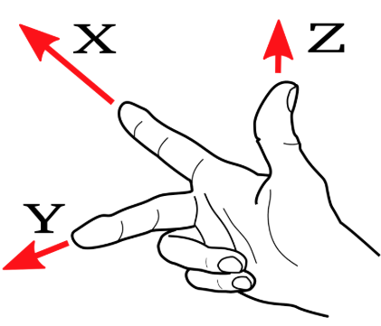

# Velkommen til Programmering på HC Ørsted Gymnasiet

I skal i dag lave en simulering af en satellit i cirkulært kredsløb om jorden.

- I skal vælge en satellit i vil simulere - finde data om satellitten og jordens radius.
- I skal lære lidt om 3D koordinatsystemer.
- I skal programmere en simpel simulering af satellittens bevægelse i p5.js.

## Satellit i kredsløb
Der er flere typer satelitter der bevæger sig i cirkulære kredsløb om jerden. Nogle navne på sattelitter er:

- Den Internationale Rumstation (ISS)
- Hubble rumteleskopet
- GPS satelitter

Her et link til satellitetracker3d, hvor I kan se forskellige satellitter i kredsløb om jorden:

[https://satellitetracker3d.com/](https://satellitetracker3d.com/)

## 3D koordinatsystemer

For at gøre dette skal vi kende lidt til 3d koordinatsystemer.
Det mest almindelige 3d koordinatsystem er et højrehåndskoordinatsystem, som ser således ud:



Et 3D koordinatsystem er en måde at beskrive positioner i rummet ved hjælp af tre akser: X, Y og Z. Hver akse repræsenterer en dimension. Lad os afprøve det i GeoGebra 3D:

- hvordan ser de tre akser ud?
- hvordan kan vi plotte punkter i 3D?
- hvad sker der når vi rotterer om en akse?

[https://www.geogebra.org/3d](https://www.geogebra.org/3d)

## Programmering i p5.js

Åben p5.js editoren og start kodningen:

[https://editor.p5js.org/](https://editor.p5js.org/)

Nedenfor ses et eksempel på hvordan man kan tegne en kugle i 3D i p5.js.

```javascript

let radius_kugle1 = 10  // variabel til kugleradius
let translationZ  = 100 // variabel til flytning langs Z aksen
let rotationOmY   = 1; // variabel til rotation om Y aksen

function setup() {
  createCanvas(400, 400,WEBGL); // opret et 3D lærred
}

function draw() { // hovedloop
  
  background(220); // baggrundsfarve

  fill(255,0,0) // farve rød

  sphere(radius_kugle1); // tegn kugle
    
}

```
Der mangler dog to vigtige js-kommandoer for at bestemme "positionen" og simulere "bevægelsen", nemlig:

```javascript
  rotateY(rotationOmY) // rotation, af hele koordinatsystem, om Y aksen
```

og

```javascript
 translate(0,0,translationZ) // flytning, af hele koordinatsystem, langs Z aksen
```


## Opgaver
1. Tegn satellitten: Indsæt rotateY()- og translate()-kommandoerne meningsfulde steder i koden, og tegn en ny sphere(), der skal fungere som din satellit.
2. Skab kredsløb: Få satellitten til at bevæge sig i en cirkulær bane rundt om Jorden.
3. Indsaml data: Find relevante data for din valgte satellit – nærmere bestemt dens afstand fra Jordens centrum (baneradius) samt dens omløbstid.
4. Skaler modellen: Tegn Jorden, satellitten og satellittens bane med de korrekte relative størrelsesforhold.

